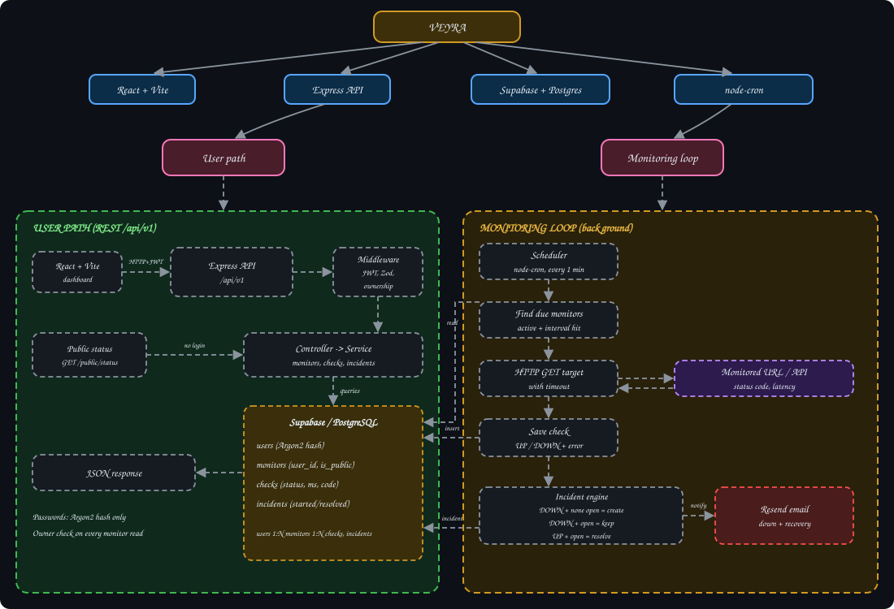

# VEYRA — Website & API Uptime Monitoring

Automated uptime monitor. Checks your URLs on a schedule, stores every
result, detects downtime, and tracks each outage as a single incident from
start to recovery.

## Features

- Monitor CRUD: name, URL, interval, active/inactive, public/private
- Scheduled HTTP health checks with full history (status code, latency, error)
- Incident lifecycle: create, keep open, resolve
- JWT auth, Argon2 password hashing, Zod request validation
- Ownership checks: users only see their own monitors
- Public status endpoint (public monitors only, minimal fields)
- Email alerts via Resend (see status in Current limitations)
- Dockerized backend

## Problem

Sites and APIs go down (crashes, bad deploys, DNS, database failures) and
developers often learn about it from users. Manual checking does not scale
past one or two services. Need something that watches continuously, keeps
history, and does not fire a new alert for every failed request.

## Architecture



**User path (REST)**

1. React dashboard calls `/api/v1` with a JWT.
2. Middleware verifies JWT, Zod validates input, ownership is checked.
3. Controller calls service, service reads/writes Supabase PostgreSQL.
4. Public status endpoint skips login and returns public monitors only.

**Monitoring loop (background)**

1. `node-cron` wakes every minute.
2. Scheduler finds active monitors whose interval is due.
3. HTTP request goes to the target URL with a timeout.
4. Result saved in `checks`.
5. Incident engine compares result with current state (table below).
6. Down and recovery events trigger a Resend email.

## Concept

**Check vs incident**

- **Check**: one monitoring attempt (`12:02 → DOWN → 503`).
- **Incident**: one continuous downtime period made of many checks.

```text
12:00  UP
12:01  UP
12:02  DOWN  → incident created
12:03  DOWN  → same incident
12:04  DOWN  → same incident
12:05  UP    → incident resolved
```

Without this split, every failed request makes a new outage record and a new
email. With it, three failed checks = one incident.

| Latest check | Open incident? | Action |
|---|---|---|
| DOWN | No | Create incident, send down alert |
| DOWN | Yes | Keep open, do nothing |
| UP | Yes | Resolve incident, send recovery alert |
| UP | No | Nothing |

**Authentication vs authorization**

- Authentication = who are you (JWT, Argon2 verified at login).
- Authorization = can you touch this monitor (`monitors.user_id` must match the token's user).

**Status rules**

`UP` / `DOWN` is decided from the HTTP result and timeout.

> Document the exact rule from your code here (for example 2xx = UP, anything else or timeout = DOWN).

## Data model

```text
users ──1:N──► monitors ──1:N──► checks
                   └──────1:N──► incidents
```

| Table | Fields |
|---|---|
| `users` | id, name, email, password (Argon2 hash), created_at |
| `monitors` | id, name, url, interval, active, user_id, is_public, created_at |
| `checks` | id, monitor_id, status, status_code, response_time, error, checked_at |
| `incidents` | id, monitor_id, started_at, resolved_at, status |

## API

Versioned under `/api/v1`:

```text
/api/v1/health
/api/v1/auth
/api/v1/monitors
/api/v1/checks
/api/v1/incidents
/api/v1/stats
/api/v1/public/status
```

Example:

```http
POST /api/v1/monitors
Authorization: Bearer <JWT>
Content-Type: application/json

{
  "name": "My Website",
  "url": "https://example.com",
  "interval": 60,
  "active": true
}
```

> Keep routes, methods and field names in sync with the real route files.

## Project structure

> Simplified. Match it to your repo.

```text
src/
├── config/        # supabase client, env
├── controllers/   # auth, monitor, ...
├── middleware/    # auth.middleware, validation, errors
├── routes/        # auth, monitor, public-status, ...
├── services/      # auth, monitor, check, incident, email
├── scheduler/     # monitor.scheduler.js
├── validators/    # Zod schemas
├── app.js
└── server.js
docs/architecture.svg
```

Request flow: `Route → Middleware → Controller → Service → Supabase → Response`.

## Build plan

1. **Core API**: Express, Supabase/PostgreSQL, auth, monitor CRUD, Zod.
2. **Scheduler + checks**: `node-cron` loop, HTTP checker, `checks` table.
3. **Incidents**: open / keep / resolve on top of check results.
4. **Notifications**: Resend down and recovery emails.
5. **Frontend**: React + Vite dashboard, history, incidents, public status.
6. **Docker**: containerized backend with env-file config.

## Explicitly out of scope

- Multi-region probing
- Full public status-page product (only a minimal public endpoint)
- SMS / phone call alerts
- Team accounts, roles, billing

## Tests

- **Auth**: register, login, wrong password, missing JWT, invalid JWT.
- **Monitors**: CRUD, invalid URL, invalid interval, access to another user's monitor rejected.
- **Checks**: success, HTTP error, timeout, network failure, slow response.
- **Incidents**: first failure creates one, repeated failures do not duplicate, recovery resolves.
- **Public status**: public monitor shown, private monitor and user info never exposed.
- **Email**: down mail, recovery mail, provider failure does not crash scheduler.
- **Docker**: container starts, env loads, API answers, scheduler starts.

## Failure modes

**Email provider down or sender not verified**

Decision: **keep monitoring, never block on email**.

- *Why:* core job is detect and record downtime. Failed email must not stop checks or incident updates.
- *Tradeoff:* alert can be missed.
- *Mitigation:* log the failure, store incident state regardless, add retry or queue later.

**Single failed request (network blip)**

Today one failed check opens an incident. This can cause false alerts.
Mitigation planned in code: consecutive-failure threshold and retry before opening.

**Backend restart**

Last-check times live in memory, so a restart resets them. Worst case: a
check runs early. No data loss, history is in PostgreSQL.

## Security

- Passwords stored as Argon2 hashes only
- JWT on every protected route + ownership check on every monitor resource
- Zod validation on all incoming data
- Secrets only in environment variables, `.env` never committed
- Supabase RLS and grants must be reviewed before production
- **SSRF risk:** VEYRA fetches user-supplied URLs. Before public deployment block
  `localhost`, `127.0.0.1`, private IP ranges, link-local addresses, cloud
  metadata endpoints, and unsafe redirects.
- Add rate limiting on auth and monitor-create routes

## Performance notes

- `checks` grows fast (monitors × checks per day). Index it:

```sql
CREATE INDEX ON checks (monitor_id, checked_at DESC);
CREATE INDEX ON incidents (monitor_id, status);
```

- Add a retention policy: delete or aggregate old checks (for example older than 30 days).
- Run checks concurrently with a cap, so many due monitors do not block the loop.
- Always set a request timeout on health checks.

## Current limitations

- **Scheduler state in memory.** Restart loses it, multiple backend instances can run duplicate checks.
- **Email:** Resend needs a verified sender/domain for real delivery. Treat as in progress until tested end to end.
- **False alerts:** no retry or failure threshold yet.
- **Single region:** one location checks everything, so a network issue on the VEYRA side looks like downtime.
- **No metrics/tracing:** logs only.

## Troubleshooting

| Problem | Likely cause |
|---|---|
| Monitor never checked | `active` is false, or scheduler not started |
| Email not arriving | Resend sender/domain not verified, or bad `RESEND_API_KEY` |
| 401 on every request | Missing `Authorization: Bearer <JWT>` or wrong `JWT_SECRET` |
| Duplicate checks | More than one backend instance running |
| Supabase permission error | RLS / grants not set for the table |
| Container exits at start | `.env` missing or variable names wrong |

## What production uses instead

- Hosted: UptimeRobot, Better Stack, Pingdom
- Self-hosted: Uptime Kuma, Prometheus + Alertmanager, Blackbox Exporter

This project is for understanding how scheduling, check history and incident
state work, not for replacing these.

## Stack

| Layer | Tech |
|---|---|
| Frontend | React, Vite |
| Backend | Node.js, Express |
| Database | Supabase, PostgreSQL |
| Auth | JWT, Argon2 |
| Validation | Zod |
| Scheduler | node-cron |
| Email | Resend |
| Infra | Docker |
| Tools | Git/GitHub, Postman |

## Setup

```bash
git clone <your-repo-url>
cd veyra
npm install
cp .env.example .env   # fill in values
npm run dev
```

### Environment variables

```env
PORT=3000

SUPABASE_URL=
SUPABASE_SECRET_KEY=

JWT_SECRET=

RESEND_API_KEY=
EMAIL_FROM=
```

> Names must match your code. Never commit `.env`.

### Docker

```bash
docker build -t veyra:latest .

docker run -d \
  --name veyra-api \
  --restart unless-stopped \
  --env-file .env \
  -p 3000:3000 \
  veyra:latest

docker logs -f veyra-api
```

## Scripts

> Replace with real scripts from `package.json`.

- `npm run dev` starts the API in development.
- `npm start` starts the API.
- `npm test` runs the tests.

## Research

- "uptime monitoring incident state machine"
- "node-cron vs BullMQ repeatable jobs"
- "SSRF protection node.js"
- "Resend domain verification"

## Author

Brij

## License

MIT